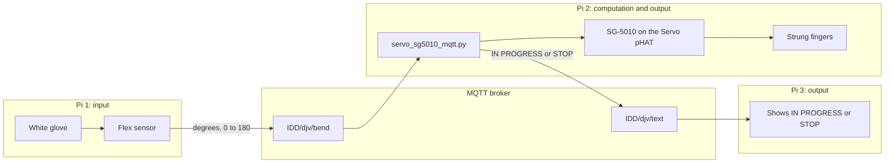

# Distributed Interaction
# TeleAbsence Hands

**Team:** Jaclyn Pham, Demi Hu, Vasudha Devkota

**Members:** Jaclyn Pham (cqp4), Demi Hu (dh785), Vasudha Devkota (vd269)

<iframe width="720" height="405" src="https://www.youtube.com/embed/xix3lFBBjuw" title="TeleAbsence, the finished piece" frameborder="0" allow="accelerometer; autoplay; clipboard-write; encrypted-media; gyroscope; picture-in-picture; web-share" allowfullscreen></iframe>

[Video](https://www.youtube.com/watch?v=xix3lFBBjuw)

## The piece

Telepresence is the appearance or sensation of a person being present at a place other than their true location. Teleabscence, coined at the MIT Media Lab's Tangible Media group, extends that concept across time and memory to connect with those who are no longer physically present. In this project, Teleabsence Hands, we let two people share touch over long distances. One person squeezes a soft glove that contains a flex sensor, which bends around their grasp. The sensor sends its reading to a paired hand at another location, which curls its fingers into a squeeze, mimicking the motion of the first hand. A third wearable computational node reads the interaction between the two and displays information so that the person who received the touch can see that the other user sent one, even when they are away from their hand. 

The squeeze matches the bend. The glove sends a number from 0 to 180. The other hand turns to that same angle. A small bend makes a small curl. A deep bend pulls the strings as far as the servo can go. Letting go sends 0, the strings loosen, and the hand opens. Any number above 0 makes the servo Pi send `IN PROGRESS` on `IDD/djv/text`. A 0 sends `STOP`. In the storyboard, that note shows up on a watch. In the build, it is a message the third Pi can display, and the broker keeps the latest one so the note is still there if that Pi connects late.


## Storyboard


A and B are two lovers. A squeezes his hand, which contains a flex sensor. B's robot hand mimics the motion at the same time and intensity. She wears a watch which also receives a notification if A squeezes his hand, so that she knows even when she's physically away from her robot hand. Once she's with the hand, she can hold it, feeling the squeeze from A no matter where he is in the world.

## Process Documentation
### Soft Sensor Hand
Version 1 of the soft sensor hand was made with tissues stuffed in a glove. The flex sensor was inserted vertically. Version 2 uses fluffy yarn for a softer, more squeezable texture with resistance and bounceback. The flex sensor is placed horizontally to better read the bend when a human hand squeezes it.
Process video, version 1 test: (video)[https://youtu.be/k6j-tZg15-8]

### Articulated Robot Hand
The robot hand was made with 3D printed fingers. The initial plan was to place these fingers inside a glove as a skeleton, then surround it with softer foam or tissue for a huggable texture. In the first version, there are two strings that run along each side, and pulling one or the other makes the finger bend in a different direction. The rigid PLA connections made the fingers rather stiff.


In version 2, we tried using articulated joints rather than living hinges. They look smoother and more readable as fingers, but the strings run parallel to the bending direction, so the fingers can only be bent in one direction and must be manually flattened again. Although version 1 would have had the movement we needed for the project (eg. letting the servo both curl and extend the fingers), due to material constraints we went with version 2. A servo motor pulls at the strings, which in turn curls the fingers.


### Pi Display
The third Pi controls not a hand but a small LED display, meant to mimic the screen of a wearable such as a smartwatch. We used the tiny OLed screen provided, and set up the final system (two hands and one screen) like the below.


### Photos


The last photo is a user test. The user described the hand as soft to the touch.


## Wireless Communication

Three Pis use the class message server, `farlab.infosci.cornell.edu:1883`. They publish and read from different addresses: IDD/djv/bend is the bending data as a number bounded from 0-180, and IDD/djv/text is the interaction state between the two hands as text such as "IN PROGRESS" or "STOPPED".



| Pi | Role | What it touches | MQTT |
| --- | --- | --- | --- |
| 1 | Input | Soft glove and bend sensor | Sends the bend on `IDD/djv/bend` |
| 2 | Computation and output | Raspberry Pi, SparkFun Servo pHAT, SG-5010, strings through the printed fingers | Listens to `IDD/djv/bend`. Sends `IDD/djv/text` |
| 3 | Output | A screen that shows the note | Listens to `IDD/djv/text` |

The number on `IDD/djv/bend` is how far the servo horn should turn. `0` means open. `180` is a full turn, which is as far as this servo can pull the strings. The glove sends new numbers many times a second, faster than the servo should keep jumping, so Pi 2 uses the newest number and moves once a second.

The note is written by the servo Pi, the one actually pulling the strings. Any angle above 0 means that Pi is turning the horn. Zero means the hand went back to open and the horn was sent home. We do not have a second sensor on the receiving fingers to check that they touched a person. `IN PROGRESS` means the number arrived and the servo was told to pull. The broker saves the last message, so Pi 3 still sees it if it connects while the hand is already closed.

```120:128:Lab 6/TeleAbsence/finger_curl_mqtt.py
def status_for(degrees):
    if degrees == 0:
        return STOP
    return IN_PROGRESS


def publish_status(client, status):
    client.publish(TEXT_TOPIC, status, retain=True)
    print(f"Sent {status} on {TEXT_TOPIC}.")
```

`servo_sg5010_mqtt.py` uses that rule, and it drives the SG-5010 with a pulse of 500 µs at 0° and 2500 µs at 180°. An earlier range, 1100 to 1900 µs, stopped short of the servo's real travel, so the curl was smaller than the number we sent. There is no language model in this loop. The little rule above runs on the servo Pi every time it accepts a new number. If the note came from the glove Pi instead, it would still say `IN PROGRESS` even when this Pi was unplugged.

| Topic | Who publishes | Payload | Meaning |
| --- | --- | --- | --- |
| `IDD/djv/bend` | The glove Pi | A number from 0 to 180, such as `0.0` or `78.9` | How far the sending hand is bent |
| `IDD/djv/text` | The servo Pi | `IN PROGRESS` or `STOP` | Whether the other hand is being pulled |

Capital letters matter. `IDD/djv/bend` is our channel. `IDD/DJV/bend` is a different channel, and it stays empty.

## What the build taught us

The person who squeezes does not see the other hand. They get the short note. The person with the other hand feels the strings and does not need a screen. That split is the project.

The glove sends a new angle many times a second. If we held each number for 10 seconds, we would miss the rest of the squeeze. The script that runs in the piece takes the newest angle once a second and stays there until the next one. The hand opens when the channel sends 0. The 10-second hold is only in `servo_sg5010_curl.py`, the test where someone types one number at a time.

This servo can turn about halfway around, and then it stops. It cannot wind the string for several full turns. One horn pulls every finger we tied on, so the hand closes all at once. The Servo pHAT also needs its own USB-C cable for the motor. Without that cable the board still shows up on I2C at `0x40`, and the servo does not move.

Next time we would add a sensor on the receiving fingers, so `IN PROGRESS` and `STOP` meant someone was actually touching the hand, not only that the servo had been told to move. A servo on each finger would let the squeeze pick out one finger. The watch text in the drawing, "Love from A!", is warmer than the two words we send. Those two words are the note a third Pi can trust.


<details>
<summary>How to run it, and the files</summary>

The SG-5010 plugs into a numbered spot on the SparkFun Servo pHAT. Tell the script that number with `--channel`. It will not guess. The Pi has its own USB-C power. A second USB-C cable, plugged into the pHAT, powers the servo. Do not power the SG-5010 from a GPIO pin or the Pi's 5 V pin. If the horn buzzes because it has hit the stop, bring `--min-us` and `--max-us` closer together and stop the script.

On the servo Pi, from `Lab 6`, with `adafruit-circuitpython-servokit` and `paho-mqtt` installed:

```bash
cd "Lab 6/TeleAbsence"
python servo_sg5010_mqtt.py --channel 0
```

Channel 0 is only an example. Use the number printed next to the plug you used.

To move the horn before the other Pis are connected:

```bash
python servo_sg5010_curl.py --channel 0
```

Type a number from 0 to 180. The horn holds it for 10 seconds, then returns to 0. `q` releases the pulse.

To send one test number the way the glove Pi does:

```bash
mosquitto_pub -h farlab.infosci.cornell.edu -p 1883 -t 'IDD/djv/bend' -m '45' -u idd -P 'device@theFarm'
```

`45` turns the horn to 45° and sends `IN PROGRESS`. A later `0` opens the hand and sends `STOP`. The real glove should keep sending the angle it is reading.

On the notification Pi:

```bash
mosquitto_sub -h farlab.infosci.cornell.edu -p 1883 -t 'IDD/djv/text' -u idd -P 'device@theFarm'
```

| File | What it is |
| --- | --- |
| `TeleAbsence/servo_sg5010_mqtt.py` | The script we run for the piece. It reads the bend, moves the SG-5010, and sends the note. |
| `TeleAbsence/finger_curl_mqtt.py` | The same MQTT loop, with the shorter pulse range from earlier tests. |
| `TeleAbsence/servo_sg5010_curl.py` | Type an angle from 0 to 180. It holds for 10 seconds, then goes back to 0. |
| `TeleAbsence/finger_curl.py` | An earlier typing test, from 0 to 90, starting at 45°. |
| `TeleAbsence/servo_sg5010_test.py` | Keyboard test for one plug: left, right, center, and a small sweep. |

</details>

## References

- MIT Tangible Media Group, [TeleAbsence](https://tangible.media.mit.edu/project/teleabsence/). The project we started from. Someone far away can still feel that you are there, through a gesture.
- MIT HCI Engineering, [Xstrings](https://hcie.csail.mit.edu/research/xstrings/xstrings.html). We used this for the string path in the printed fingers. One string runs through the joints, and pulling it closes the finger.
- Gyrobot, [Flexy Hand](https://youtu.be/Z70YWNuOB8E?si=lgnRUYCbhTde_MYc). The printed hand we built the fingers and palm from.
